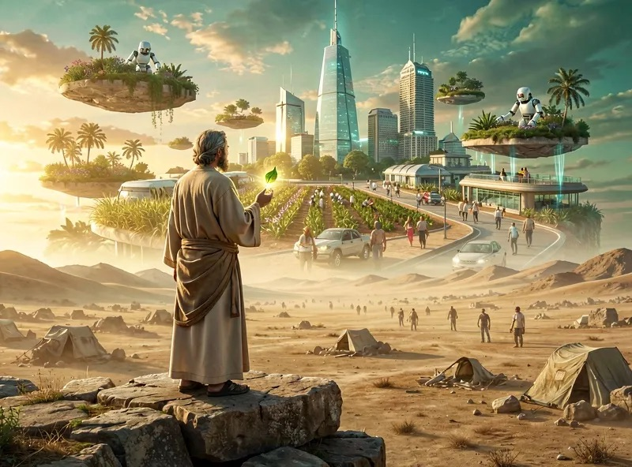

# The last occupation will be prophet.

"Greed" is definitely not infinite. The myth that people can have infinite desires comes from the fact that scarcity used to be prevalent in the world. Yet, as needs get fulfilled, scarcity is slowly eliminated, and eventually everything you believed about desire gets flipped on its head.

Of course, like, metaphysically, as long as one still experiences time, there is something they want, or at least some preference. In subjective logic, when no choice will ever be made, time ends.

But desire can "run dry" way before time ends. Because people's imagination is limited. Especially those who grew up in a world of scarcity. The bottleneck in a world of scarcity is the volume of supply of desired things. But in a world of abundance, the bottleneck becomes the amount of demand people can generate.

It is very telling which stage we are at, when oversupply of cheap imports is becoming an existential crisis for first world countries. Abundance is on the horizon, and no matter how one tries to spin it, the problem humanity will soon have is figuring out where the final frontiers of scarcity lie, because only there will demand for labor (JOBS) be found.

And thus imagination becomes crucial. Even with physical abundance, we cannot get what we (collectively) cannot imagine. Imagination becomes the bottleneck.

People may think they are imaginative, but to be brutally honest, the vast majority of humans are no better than stochastic parrots (i.e. frontier LLMs). Some people might be slightly more creative in the sense that at least they can adventure outside the statistical normal for a SD or two, but in the end, their ideas come from somewhere tangible.

Radical imagination must seem crazy. Insanity is when one goes *way* outside the range of statistical norm, but if statistics offer no help, how do we tell whether it is "bad" crazy or "good" crazy? The normal person, at least of this era, simply cannot tell.

In a couple decades, when the world of abundance fully replaces the world of scarcity, the only proper job remaining for humans is the prophet. The prophet is crazy, and the prophet can imagine desirable futures that other normal human beings don't even know they want. But despite rejection, the prophet plants the seed for the future, and eventually, perhaps after many years, the idea will bloom and people will finally see that such futures are desirable, and thus new desire (demand) is created.

The world rejoices, because it has created a new purpose. An event that will become so rare that it is worthy of celebration, not unlike how people get excited when somebody discovers a gold mine in the days of scarcity.

While awaiting the next prophetic revelation being recognized, artifical scarcity is sometimes imposed upon willing people, to experience the sense of purpose, for fun. It's basically a game. In the same way we play fantasy games involving medieval warfare, fighting with swords and shields, people in the age of abundance would create immersive games of scarcity, because that's what people do. It is said that this world is one such game. A special one, created intricately, on a grand scale, high difficulty. And if we, in this world, finally transform back into abundance, we will create more games of scarcity. Perhaps. Perhaps such inception never ends.
